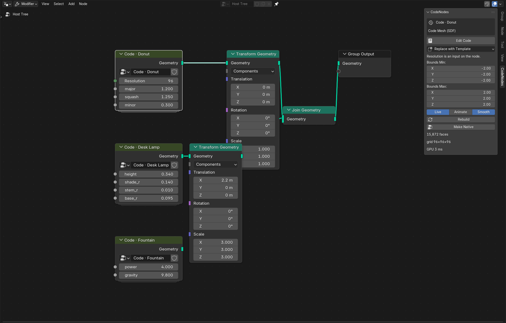
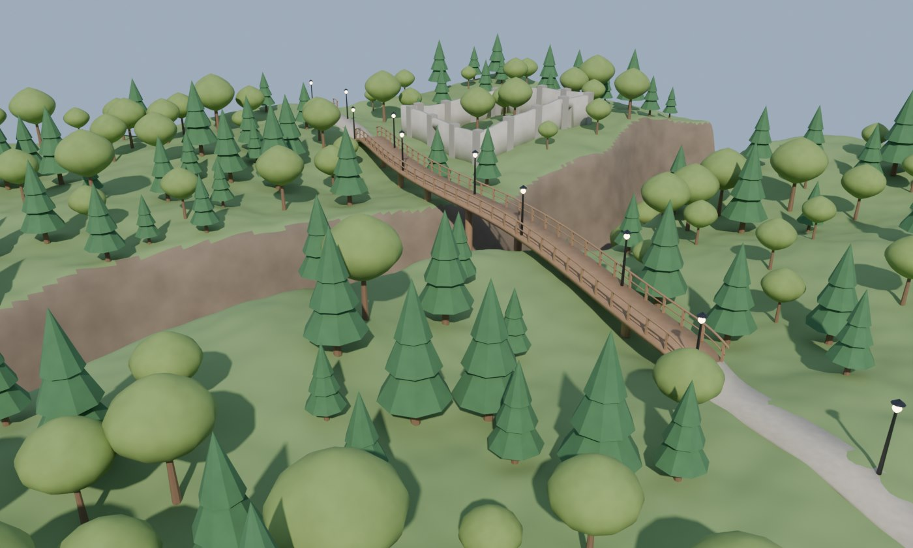
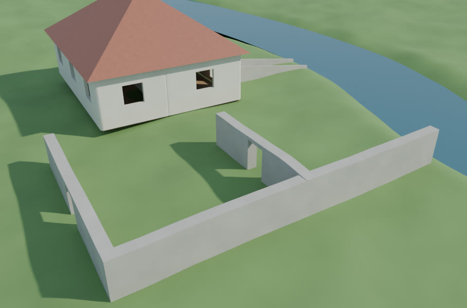
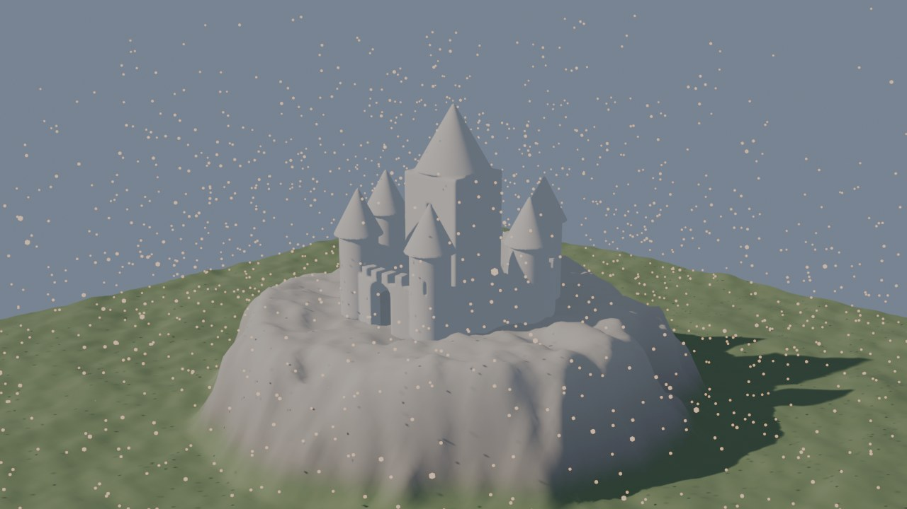
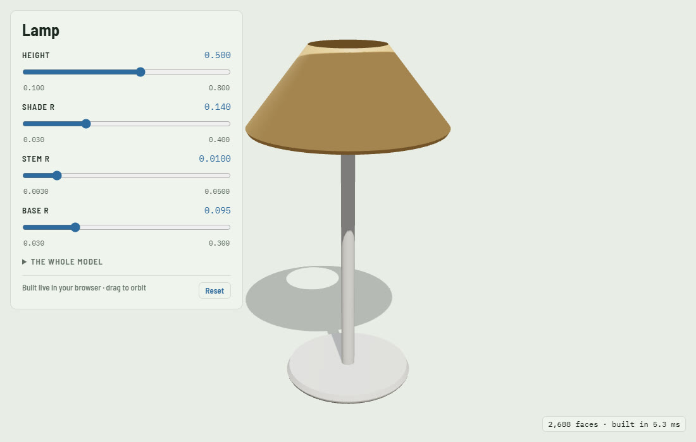
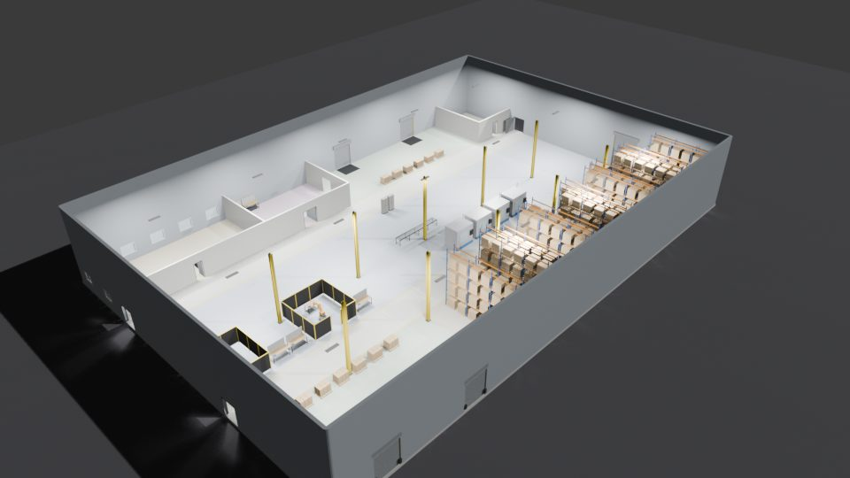

# CodeNodes

**Write your own Geometry Nodes nodes in code.** A code node's code says what goes in, what comes
out, and the maths in between. Wire it into a Geometry Nodes tree beside Blender's own nodes, feed it
from them, feed them from it, and tune it with sliders.

**Made for writing with Claude.** Claude is good at maths and geometry code. CodeNodes lets it write
code and gives you the result as nodes you keep editing: move a slider, add your own nodes around
it, or ask Claude to change the code. A Claude Code plugin (an MCP server and a skill) comes with it.



> **Status: early (v0.6), and the main goal isn't reached yet.** Code nodes that Geometry Nodes
> itself evaluates, inside your tree, with fields going in and out, work today for maths without
> loops, through the companion add-on [ExpressNode](https://github.com/quacktheplanet/ExpressNode).
> Loops, lists and geometry operations come next. [Where it stands](#where-it-stands) says what works
> now; [TODO.md](TODO.md) has the roadmap.
>
> Tested on Blender 5.0, 5.1 and 5.2: on Windows with OpenGL, and on Linux with OpenGL and Vulkan
> (including headless), all on NVIDIA GPUs. AMD, Intel and macOS haven't been tried yet.
>
> **Licence:** GPL-3.0-or-later.

## Where it stands

Code meets Geometry Nodes in four ways today. What sets them apart is who runs the code, because
that decides what you can do with the result.

| | You write | Who runs it | What you get | State |
|---|---|---|---|---|
| **Native code nodes** | Python-style maths: `def ripple(P, t, amp=0.3): ...` | Geometry Nodes: the code is compiled into stock nodes | fields in and out; works per object, in the modifier stack, in bakes and on render farms; the file opens without any add-on | maths only, no loops yet; lives in [ExpressNode](https://github.com/quacktheplanet/ExpressNode) |
| **Code Shapes** | a small shape language: profiles, revolve, extrude, sweep, loft | CodeNodes, in Python (and in JavaScript in a browser) | exact meshes with sharp edges and real UVs, a slider for every `param` | works |
| **GPU code nodes** | GLSL: particles, distance-function surfaces, code on every vertex | your graphics card, drawn live over the viewport by CodeNodes | millions of particles live; **To Geometry** turns the result into real geometry | works, but Geometry Nodes doesn't run them: a field wired in is read at the origin |
| **Geometry Nodes as data** | nothing: an assistant reads and writes your trees | Blender | Claude builds, explains and edits ordinary node trees without breaking them | works |

## Where it's going

The goal is the first row without its limits:
- a code node in your tree whose sockets follow its code as you type
- compiled into stock nodes, so Geometry Nodes runs it like any other node
- loops (Repeat zones), lists (Blender 5.2), state between frames (Simulation zones), geometry
  operations and your own functions
- code nodes wired to each other and to Blender's nodes
- as fast as the same nodes built by hand

The GPU nodes stay, as the live preview and effects side. The building generator and the node-group
library are moving to a repository of their own (see
[Moving out](#moving-out-buildings-and-the-node-group-library)).

## Requirements

- **Blender 5.0 or newer.**
- **A GPU** for the live GPU features. On Blender 5.0 and 5.1 they need a Blender window, because
  background Blender (`-b`) has no GPU there, so bake first for headless renders. On 5.2 and newer,
  background Blender has a GPU, and command-line renders include GPU nodes. Shapes, Geometry Nodes and
  the web export work headless on every version.
- **To use it with Claude:** Claude Code, and Python 3.10+ on the PATH (the MCP server uses the
  standard library only: nothing to install).

## Install

1. **Get the extension zip.** Download it from the Releases page once one is published, or build it
   from a clone of this repo:

   ```
   mkdir dist
   blender --command extension build --source-dir codenodes --output-dir dist
   ```

   That writes `dist/codenodes-0.6.0.zip` (Blender needs the `dist` folder to exist first).
2. **Install it.** Edit › Preferences › Get Extensions › the ⌄ menu at the top right ›
   **Install from Disk…** › pick the zip. It's enabled straight away.

## Use it with Claude

CodeNodes comes with a Claude Code plugin: an MCP server that drives the add-on, and a skill that
teaches Claude how to use it. Two commands, once:

```
claude plugin marketplace add quacktheplanet/CodeNodes
claude plugin install codenodes@codenodes
```

Then open Blender (with the add-on installed) and ask Claude for something: *"use CodeNodes to make a
vase with a wavy rim and render it"*, or *"make a donut code node and wire three copies into a
Join"*. There's nothing to start or copy in Blender: the add-on lets assistants on this computer
connect by itself, and the MCP server finds the open Blender (or lets Claude pick one when several
are open).

- **Turning it off:** Edit › Preferences › Add-ons › CodeNodes › **Let assistants connect**.
- **Only this computer can connect.** The link listens on 127.0.0.1 and checks a random token that
  Blender writes to `~/.codenodes/` for the MCP server to read. It doesn't start in background
  (`-b`) Blender.
- **Fixed tool list.** The add-on answers only the names in its own tool table; there is no tool
  that runs arbitrary code in Blender.
- **Without the plugin:** any MCP client can run the server directly:
  `claude mcp add codenodes -- python path/to/CodeNodes/mcp/run_server.py`.

## Quick start

| To try | Do this |
|---|---|
| A native code node | Install [ExpressNode](https://github.com/quacktheplanet/ExpressNode). In a Geometry Nodes editor press N › **ExpressNode** tab, type a function, click **Add Expression Node Group**, and wire its **Result** into anything. |
| Code → Shape | Add › Mesh › **Code Shape**. Sliders appear on the node for every `param` line. |
| Geometry Nodes capabilities | From a clone of this repo: `blender -b --factory-startup --python examples/village_demo.py -- out` builds and renders the village shown below into `out/`. |
| GPU Particles | Geometry Nodes › Shift A › CodeNodes › **GPU Particles › Galaxy** (or Flow, Attractor…), wired to the output; play the timeline. |
| GPU Surface | Shift A › CodeNodes › **GPU Surface › Castle**; add **To Geometry** after it for a real mesh. |
| GPU Mesh | Wire any mesh into Shift A › CodeNodes › **GPU Mesh › Wave**, then **To Geometry** for the modified mesh. |
| The demo scene | `blender --factory-startup --window-geometry 0 0 1600 960 --python examples/gpu_demo.py -- out` builds `out/codenodes_demo_v3.blend` (a Fireflies scene and a Bend scene) and renders it. |
| Code → Volume | From the Python console: `from bl_ext.user_default.codenodes import api, volume` then `api.code_to_volume(volume.TEMPLATE, name="Smoke")`. |
| Node editor | Open a Node Editor and switch its type to **CodeNodes** (or Sidebar › CodeNodes › **New Node Graph**). |
| Web page with sliders | `blender -b --factory-startup --python examples/web_simple.py -- courtyard.html`, then open the page in a browser. |
| The library without the add-on | Open anything in [`geonodes/`](geonodes/) in plain Blender (see its README). |

The examples run straight from a clone (they load CodeNodes from the repo, no install needed) and
are listed in [examples/README.md](examples/README.md). Everything below goes into
each feature in more detail.

## Native code nodes, today

[ExpressNode](https://github.com/quacktheplanet/ExpressNode) compiles a short Python-style function
into an ordinary Geometry Nodes group, with the function's parameters as inputs and a **Result**
output. Geometry Nodes evaluates it like any other group, so fields work both ways:

```python
def ripple(P, t, freq=6.0, amp=0.3):
    return vec3(0.0, 0.0, sin(P.x * freq + t) * amp)
```

In a Geometry Nodes editor, press N, open the **ExpressNode** tab, type the function and click **Add
Expression Node Group**. Then wire **Result** into Set Position's Offset, or into anything else. It
handles maths, `if`/`else`, your own helper functions, noise and attributes. It doesn't handle loops
or geometry operations yet.

CodeNodes uses the same compiler in three places. All three are experimental and need ExpressNode
installed:
- **Make Native** replaces a GPU Surface node with stock nodes that do the same maths
- **Bake to Nodes** turns a Code → Mesh distance function into a node network
- the **render form** compiles GPU Mesh code and warps into nodes, so they render with no GPU

Bringing this into CodeNodes' own code nodes is the next step (see [Where it's going](#where-its-going)).

## Code Shapes

Maths turned into a model that is *constructed* rather than sampled. Declare sliders, describe a 2D
profile, then spin or push it:

```
param height  0.34  0.10 0.80   # Height of the lamp
param radius  0.14  0.03 0.40

part shade
  profile
    move  radius * 0.38, height
    curve x = radius * (0.38 + 0.62 * t)  y = height - height * 0.22 * t  steps 20
  revolve segments 72
```

Every number can be maths, so the whole object is one formula. Because the mesh is built rather
than marched, **edges land exactly where the maths puts them, corners stay sharp, the quads follow
the form, and the UVs mean something**: good for lamps, bottles, columns, walls and anything turned
or extruded. Add › Mesh › **Code Shape**, or `api.code_to_shape(source)`.

| command | what it does |
|---|---|
| `param name default min max  # tooltip` | a slider (a comment at the end of the line is its tooltip) |
| `part name [add\|subtract\|intersect]` | a piece, and how it combines with the others |
| `profile` › `move` `line` `arc` `curve` `close` `shell` | a 2D outline; `shell` gives an open one thickness |
| `path` › `move` `line` `curve` `helix` | a 3D route to carry a profile along |
| `revolve` `extrude` `sweep` `loft` | turn the profile(s) into a solid |
| `translate` `rotate` `scale` `array` | place and repeat it: `translate 0, 0, 1` or just `translate z 1`, `rotate x 90`, `scale 2` (even) or `scale z 2` |
| `bevel width segments n` | round the sharp edges |
| `finish` | a last block: `bevel`, `smooth`, applied to the whole thing |

Functions: `sin cos tan asin acos atan atan2 sqrt abs sign floor ceil round exp log pow min max mod
hypot clamp mix smoothstep radians degrees`, plus `pi`, `tau`, `e`, and `t` inside a `curve`.
`a if condition else b` picks between two values. Both sides are worked out (a `curve` computes
every step at once), so every name on either side must exist, even on the side that isn't used.
Arguments are separated by commas, and commas inside a call such as `max(1, 2)` stay with it.

`subtract` lets one part cut another (a hole drilled through a block), `sweep` along a `helix`
makes springs and screw threads (a path that ends where it starts, such as a full turn with no
pitch, joins into a ring with no end caps), and `loft` blends one profile into another. **Profile as Curve**
draws the outlines as a real curve object, which is far easier to judge by eye than a column of
numbers.

It is a language CodeNodes parses itself, not Python, so a description from anywhere is safe to
build.

## Geometry Nodes, built and edited by an assistant



*Terrain with a canyon, a trail that turns into a bridge where it crosses, a walled courtyard that
follows the ground, a forest that keeps clear of both, lamps along the trail, and the trees and
lamps modelled in the shape language. Every step was one tool call:
[`examples/level_demo.py`](examples/level_demo.py). Built in under a second, rendered in 11.*

`codenodes.gn` lets an assistant work with ordinary Geometry Nodes: build a setup, understand one
that already exists, and change part of it without disturbing the rest.

**A library of tested capabilities** to compose rather than write from nothing. (This library is moving to its own repository: see
[Moving out](#moving-out-buildings-and-the-node-group-library).) Each is an ordinary
node group with its controls as modifier sliders, seeded so the same seed gives the same result:

| capability | what it does |
|---|---|
| `terrain` | rolling ground from noise; an optional winding canyon; rock on anything steeper than Cliff Angle |
| `scatter` | trees, rocks, props over a surface, kept off steep slopes and clear of paths and buildings, picked from a collection |
| `wall` | a solid wall along a curve with doorways and posts; follows uneven ground and stays vertical |
| `path_bridge` | a walkway that hugs the ground and becomes a bridge (railings, posts, pillars) wherever the ground falls away |
| `along_curve` | things beside a curve at a spacing (lamps, benches): one side, both, or alternating |
| `wall_network` | walls along every spline of a curve, joined into one solid at corners, T's and crossings; doorways that keep off the junctions |
| `rooms` | a floor plan of closed outlines → floors, walls joined where rooms touch, one doorway between each pair of rooms, windows along outside walls, an entrance |
| `roof` | flat, gable or hip (equal pitch all round) with an overhang, stacked after `rooms` on the same object |
| `stairs` | stairs (even steps no taller than Step Height) or a ramp along a curve, between its two end heights, solid to the ground, optional side walls |
| `water` | a water surface along a curve, and terrain's **Carve** inputs, which cut a riverbed (or flatten a road) along a curve and ease the banks back |



*A house from a three-room floor plan with a hip roof, a yard of walls meeting at a T and two corners
on uneven ground, stairs, and a river carved into the terrain:
[`examples/village_demo.py`](examples/village_demo.py).*

```python
agent.curve("Trail", [[-9, -44, 1], [0, -8, 1.6], [12, 44, 1]])
agent.nodes_use("path_bridge", "Trail", {"Ground": "Ground", "Gap Depth": 1.2})
agent.nodes_set_inputs("Trail", {"Width": 3.0})          # later: "make it wider"

agent.curve("House", splines=[[[0, 0], [7, 0], [7, 5], [0, 5]],     # rooms share corners
                              [[7, 0], [11, 0], [11, 5], [7, 5]]], cyclic=True, smooth=False)
agent.nodes_use("rooms", "House", {"Entrance": 0})
agent.nodes_use("roof", "House", {"Style": 2})             # the next modifier: sits on the walls
```

**Any node setup, as data, both ways.** The catalog is read out of Blender itself (about 320 node
types) and says for every socket **whether it can take a field or only a single value** (the most
common way a setup goes wrong) and, for Blender 5's menu sockets, what the choices are.

```python
agent.nodes_find("distribute points")     # what exists, and exactly what it takes
agent.nodes_write(description)            # build a tree from plain data; sockets named plainly
agent.nodes_explain("MyGroup")            # an existing tree in words, in flow order
agent.nodes_edit("MyGroup", [{"op": "insert", "node": {...}, "between": {...}}])
agent.nodes_check("MyGroup")              # what came out: mesh, curves, points, instances, size
```

- **The round trip is lossless**, including the parts that usually break: nodes whose sockets you
  add yourself (Capture Attribute, Repeat and Simulation zones, Menu and Index Switch), whose socket
  identifiers are *not* stable across a rebuild; groups inside groups; panels.
- **Edits are all or nothing** (tried on a copy first) and keep the group's socket identifiers, so
  values tuned on the modifier survive.
- **Mistakes are explained in terms of the node**: *"'Value' is a field (it varies per element) but
  'Vertices X' on 'grid' takes a single value"*, or *"'grid' has no input 'Sise'. It has: Size,
  Vertices X…"*.

The same tools are MCP tools, alongside `material`, `collect`, `curve`, `light("outdoor")`,
`look_at` and `render`, so an assistant can build a scene, look at it and fix what it sees.

## GPU code nodes



*The demo scene (`examples/gpu_demo.py`), rendered with F12: a plateau shaped by a GPU Mesh node,
the Aerie citadel as a GPU Surface raymarched live, and fireflies from a chain of six code nodes.*

Code nodes written in GLSL, run on the graphics card and drawn live in the viewport. Each node's code
declares its inputs and outputs. Wire nodes into chains and graphs, and every path compiles into one
GPU program:
- **GPU Particles:** a particle source you write, then stages for what the particles do and how they
  look (millions of particles, live)
- **GPU Surface:** a distance function, raymarched live
- **GPU Mesh:** code run on every vertex of the mesh wired into it
- **GPU Stage:** one step in a chain: a behaviour, a look, a warp, or functions for other nodes

**How they fit into Geometry Nodes.** Blender doesn't let add-ons add new node types to Geometry
Nodes, so a GPU code node is an ordinary Group node: CodeNodes runs its code and draws the result over
the viewport. Geometry Nodes doesn't evaluate it. Values come in from Value nodes, reroutes or the
modifier's inputs, and a field wired in is read at the origin. **To Geometry** after a chain turns it
into real points or a mesh that the rest of the tree, renders and exports can use. F12 and the Render
menu include GPU nodes without a bake, and the same code runs in a browser (WebGL2).

- [docs/GPU_TOUR.md](docs/GPU_TOUR.md): a hands-on walk through the firefly chain, the Windy Meadow
  and the Galaxy
- [docs/GPU_NODES.md](docs/GPU_NODES.md): how nodes, chains, rendering, baking and lighting work,
  and their limits
- [docs/NODE_REFERENCE.md](docs/NODE_REFERENCE.md): every node, with its code and every socket

## Code → Mesh, Volume and Particles

Besides code nodes, CodeNodes turns code straight into geometry on an object, from the Add menu, a
script or an assistant:
- **Code → Mesh:** a GLSL distance function becomes a watertight quad mesh
- **Code → Volume:** a density becomes an OpenVDB volume that renders natively
- **Code → Particles:** a solver you write becomes a point cloud with velocity, age and life
- **The CodeNodes node editor** combines distance functions into one GPU program
- **Bake to Disk** and **Bake to Nodes** make animations render anywhere, with no GPU

All of it, with code examples and how CodeNodes keeps Blender from crashing, is in
[docs/SCRIPTED_OBJECTS.md](docs/SCRIPTED_OBJECTS.md).

## Driving it from an assistant

`codenodes.agent` is the surface an assistant works through. Every call returns a plain dict and
never raises for a fixable mistake, so a model can read the error, fix its code and try again:

```python
from bl_ext.user_default.codenodes import agent
agent.help()                                   # the kinds, the GLSL helpers, a template for each
agent.make("mesh", code, name="Ring")          # or "particles" / "volume" / "shape"
agent.set_params("Ring", radius=1.4)
agent.look_at("Ring"); agent.light("studio")   # frame it, light it
agent.render()                                 # -> {"path": "...png"} to open and look at
agent.scene()                                  # what exists, with each object's kind and sliders
agent.bake("Ring", 1, 48)
```

`look_at` and `light` exist because a render with no camera aim or lighting comes out black, which
wastes a whole round trip.

**Over MCP.** `mcp/` is an MCP server (standard library only) that exposes those functions to an
assistant, so it can build something, render it and look at what it made; the Claude Code plugin
runs it for you (see [Use it with Claude](#use-it-with-claude)). It only accepts connections from
this computer and **has no way to run arbitrary code in Blender**: the add-on answers only the names
in its own tool table. See [mcp/README.md](mcp/README.md).

## To the web, with sliders

`agent.web_page` writes a scene as one self-contained page (three.js, orbit controls) with a slider
for any modifier input, and it runs headless:

```python
agent.web_page("level.html", title="Canyon Crossing", sliders=[
    {"object": "Courtyard", "input": "Doorways", "values": [0, 1, 2, 3, 4]},
    {"object": "Trail", "input": "Gap Depth", "values": [1.2, 4, 20], "unit": "m"}])
```

Geometry Nodes can't run in a browser, so every slider position is built in Blender first and
exported as glTF. Each slider is tried at every value to find what it *really* changes, and sliders
that change the same objects are baked as combinations, so the page never shows a mix that couldn't
exist. [`examples/web_demo.py`](examples/web_demo.py) turns the level above into a 5.8 MB page with
four sliders, and [`examples/web_simple.py`](examples/web_simple.py) makes a small one.

**Code Shapes go live instead.** A shape is written in CodeNodes' own small language, so the browser
can build it itself: `agent.web_shape` (MCP `web_shape`) writes a page carrying the shape's text and
a JavaScript copy of the builder, and every slider rebuilds the mesh as it moves, at any value.
Nothing is baked, and the page is about 60 KB. The lamp rebuilds in 5–10 ms.

```python
agent.make("shape", TEMPLATE, name="Lamp")
agent.web_shape("lamp.html", object="Lamp", colors={"shade": [0.9, 0.55, 0.2]})
```



The JavaScript (`codenodes/shapes/shapes.js`) is a line-for-line port, and `tests/test_shape_js.py`
holds it to the Python: every command, at several slider values, gives the same vertices to float32
precision and the same faces in the same order. Parts that cut other parts (`subtract`, `intersect`)
need Blender's boolean solver, so those shapes are refused (bake them with `web_page`); bevels are
left off.

The `web/` folder has a few standalone graphics showcases (a raymarched citadel, a procedural planet,
a million-particle simulation, a raster flythrough, a mesh editor) made alongside CodeNodes; open
them in a browser with WebGL2. Two of them load three.js from a CDN, so they need an internet
connection.

## Moving out: buildings and the node-group library

Two parts of this repository are outside CodeNodes' main job and are moving to a repository of their
own: the capability library (terrain, scatter, walls, rooms, roofs, stairs, water and paths, in
`codenodes/gn/library.py`) with the [`geonodes/`](geonodes/) assets, and the building generator
(`codenodes/factory/`). The tools for reading, writing and editing Geometry Nodes trees stay. Until
the move, everything works as described here.

### Buildings from a spec (experimental)

"Make me a 60 x 40 m factory floor with docks, racking, machining, two robot cells, QA and offices"
becomes a spec (spaces with areas, closeness ratings, material flow, equipment), and six tools do the
rest:

```python
agent.plan_site(spec, name="Plant")      # or example="factory"; a plan, a text grid, a picture
agent.edit_plan("Plant", [{"op": "swap", "a": "QA", "b": "Offices"}])
agent.build_plan("Plant")                # walls with every door and dock cut, roof, columns, lights
agent.place_equipment("Plant")           # conveyors, fenced robot cells, rack rows, machine rows
agent.verify("Plant")                    # collisions, aisles, egress walk, reach, floating parts,
                                         # openings, mesh intersections; renders three views
agent.assets("robot_arm")                # a generator's sliders, clearances and joints
```

The same six are MCP tools. Everything is built from the Geometry Nodes library and 17 parametric
generators. It's a first pass: layouts are sensible and every check passes, but the equipment is
simple and blocky and house plans come out boxy. How it works and why:
[docs/MODELING_RESEARCH.md](docs/MODELING_RESEARCH.md).



## Everything in it

| Feature | What it does | Status |
|---|---|---|
| **Code → Mesh** (scripted object) | GLSL signed distance function → watertight quad mesh, sampled on the GPU | works |
| **Code → Shape** | a small shape language → exact, constructed meshes with sharp edges and real UVs | works |
| **Code → Volume** | GLSL density → OpenVDB volume that renders natively | works (script/API only, no panel yet) |
| **Code nodes you write** | a node's code declares its inputs (sliders, whole numbers, colours, functions) and outputs (streams, functions, per-particle attributes); sockets follow the code as you type | works |
| **Graphs of code nodes** | streams split into branches (branches that only differ in looks share one simulation), merge with Join Particles, and one function feeds any number of nodes; every path compiles into one GPU program; errors name the node and line | works |
| **GPU Cache** | bake a live particle simulation to disk (16-bit floats, compressed, next to the .blend) and play it back; Blender's own Bake node works after To Geometry too | works |
| **Scene Lights / Material Look** | your lamps, world and Blender materials on code nodes: lit looks for particles, and lit GPU Surfaces | works |
| **GPU Particles** | a particle source you write, drawn live (millions); Emit From another object's surface; To Geometry → points with velocity, age, life and the chain's attributes | works |
| **GPU Stage** | behaviours, looks (glow, fireflies with flapping wings), warps (Bend, Taper on particles and meshes), mesh stages, functions | works |
| **GPU Surface** | a distance function raymarched live in the viewport, lit, depth-tested with your objects; To Geometry → a watertight mesh | works |
| **GPU Mesh** | code run on every vertex of the mesh wired into it; To Geometry → the same topology with new positions, `color` and `value` | works |
| **To Geometry** | the node that turns a GPU node's result into real geometry: When (every frame / when changed / only for render), limits, attributes | works |
| **Rendering GPU nodes** | F12, Ctrl+F12 and the Render menu: GPU and renderer take turns per frame, no bake needed | works |
| **Everything on the node** | settings as node inputs (Template dropdown, count, colours, toggles), status in the header, ✎ Edit Code toggle opens a code pop-up | works |
| **Node editor** | code nodes with typed sockets that compile into one GPU program | works |
| **Bake to Disk** | animations written to files that play back with stock nodes; renders with no GPU and no add-on | works |
| **Use lines** | each node decides what a shared function input (a wind field, say) means to it; one function, many meanings | works |
| **Lists** | a List node (a table you edit) and list inputs on code nodes; real Geometry Nodes lists on Blender 5.2 | works |
| **Explode / Collapse** | pull a script's top-level pieces (constants, helper functions) onto the graph and put them back; code nodes work inside node groups | works |
| **Computed values into code nodes** | values computed by other nodes (Math, Scene Time…) feed code-node inputs | works (fields are read at the origin) |
| **Live web pages from code nodes** | particle chains, GPU Surfaces and mesh chains run in a browser (WebGL2) with each node's sliders | works |
| **Render form** | GPU Mesh code and warps compiled to native Geometry Nodes, so they render with no GPU code at all | experimental (needs the ExpressNode add-on) |
| **Bake to Nodes** | the GLSL itself becomes a Geometry Nodes network | experimental (needs the ExpressNode add-on) |
| **Claude plugin (MCP + skill)** | Claude builds, renders and looks at its work in your open Blender; nothing to start in Blender; fixed tool list, no arbitrary code | works |
| **Geometry Nodes agent** | build, explain and edit any node tree as data; a library of tested capabilities (terrain, scatter, walls, rooms, roofs, stairs, water, paths) | works |
| **Web pages** | a scene as one self-contained page with sliders; Code Shapes rebuild live in the browser | works |
| **Buildings from a spec** | a written spec → floor plan → building → equipment → checks (factories, warehouses, simple houses) | experimental |
| **`geonodes/` library** | node-group assets and example scenes that open in plain Blender, no add-on needed | experimental |

## Known limitations

- **Native code nodes do maths only:** no loops, lists or geometry operations yet, and they need the
  ExpressNode add-on.
- **GPU code nodes aren't evaluated by Geometry Nodes:** a field wired into one is read at the origin,
  and the live result is a viewport overlay until **To Geometry** turns it into geometry.
- **Tested on NVIDIA only:** Windows (OpenGL) and Linux (OpenGL and Vulkan). AMD, Intel and macOS
  (Metal) haven't been tried.
- On Blender 5.0 and 5.1, GPU code needs Blender with a window; bake first for headless renders. On 5.2+
  background Blender has a GPU.
- Code → Volume has no node or panel yet; it's used from scripts and the assistant.
- Surface nets rounds off sharp edges and corners slightly. For crisp edges, use Code → Shape.
- Baked file paths are absolute, so moving a .blend with a bake breaks its playback. A relative-path
  mode is planned.
- Roofs cover a plan's bounding box; L- and T-shaped plans don't get proper roofs yet.
- Buildings from a spec and the `geonodes/` library are experimental (see above).
- Bake to Nodes and the render form need the ExpressNode add-on.
- GPU nodes and Blender objects don't shadow each other, and the live additive glow isn't tone-mapped
  in the Solid viewport (dense glow can clip to white).

## Tests

**The easy way:** run every suite on every Blender you have.
- **Windows:** `powershell -File tools/testing/run_all_cn.ps1 -Blender <blender.exe>,<blender.exe>`.
  Windowed suites run on a hidden desktop, so no window appears while you work.
- **Linux:** `tools/testing/run_all_linux.sh <blender> [<blender> ...]` runs everything headless. For
  the window-only suites too, use `eval "$(tools/testing/xvfb_linux.sh)"` and `GPU_BACKEND=vulkan`.

Individual suites, a selection (`tests/` has the rest: GPU nodes, graphs, Uses, Lists, Explode, groups,
the web export, the render form, F12):

```bash
python tests/test_mesher.py                                    # mesher, no Blender (17 checks)
python tests/test_graph.py                                     # graph compiler, no Blender (16)
python tests/test_shapes.py                                    # maths, the kernel, the language (98)
python tests/test_shape_js.py                                  # the browser's copy builds exactly what Python does (23)
python tests/test_rpc.py                                       # the MCP wire protocol, and the MCP server matches the add-on (31)
python tests/test_factory.py                                   # spec, planner, generators, layout, verifier, edits (129)
blender --factory-startup --python tests/test_blender.py       # needs a window: the GPU isn't available with -b (29)
blender --factory-startup --python tests/test_nodes.py         # node editor, incl. save/reload (30)
blender --factory-startup --python tests/test_bake.py          # baking, and playback through stock nodes (18)
blender --factory-startup --python tests/test_bake_nodes.py    # code to nodes, against the GPU mesh (11; needs ExpressNode)
blender -b --factory-startup --python tests/test_farm.py       # the bake renders with no GPU and no add-on (10)
blender --factory-startup --python tests/test_volume.py        # density code -> OpenVDB -> Volume object (16)
blender --factory-startup --python tests/test_particles.py     # GPU particle solver, incl. baking (22)
blender --factory-startup --python tests/test_agent.py         # the assistant-facing surface (31)
blender --factory-startup --python tests/test_live_preview.py  # template switching stress, safe errors, the paused preview (11)
blender --factory-startup --python tests/test_shape_blender.py # shapes as Blender objects (36)
blender --factory-startup --python tests/test_server.py        # a real socket client against Blender (26)
blender -b --factory-startup --python tests/test_gn.py         # Geometry Nodes as data, both ways (60)
blender -b --factory-startup --python tests/test_gn_library.py # every capability; editing real trees (72)
blender -b --factory-startup --python tests/test_web.py        # a scene as a web page with sliders; a live shape page (16)
blender -b --factory-startup --python tests/test_factory_blender.py   # building, equipment, scene checks, house (30)
blender -b --factory-startup --python tests/test_geonodes_library.py  # geonodes/ in plain Blender, no add-on (15)
node tests/web_shape_check.mjs <page folder>                   # a live shape page in headless Edge (7; needs puppeteer-core)
powershell -File tests/install_check.ps1 -Python <venv python> -Work <scratch folder> -Blenders <blender.exe>,...
    # the zip installed as a user installs it, then the whole loop through the real MCP process (29 per version)
```

Run `test_bake.py` before `test_farm.py`: the first saves the .blend the second opens. The
windowed tests quit by themselves when they finish. Test output goes to your temp folder, not the
repo.

## Project layout

| Folder | What's there |
|---|---|
| `codenodes/` | the Blender extension (the part you install) |
| `mcp/` | the MCP server that connects an assistant to the extension |
| `geonodes/` | node-group assets and example scenes that need no add-on |
| `examples/` | scripts that build the demo scenes and pages |
| `web/` | standalone browser showcases |
| `docs/` | roadmap, research notes and images; start at [docs/README.md](docs/README.md) |
| `tests/` | the test suites above |

## Licence

GPL-3.0-or-later, like Blender itself: see [LICENSE](LICENSE). That covers the add-on, the MCP
server, the node-group assets and the examples.
