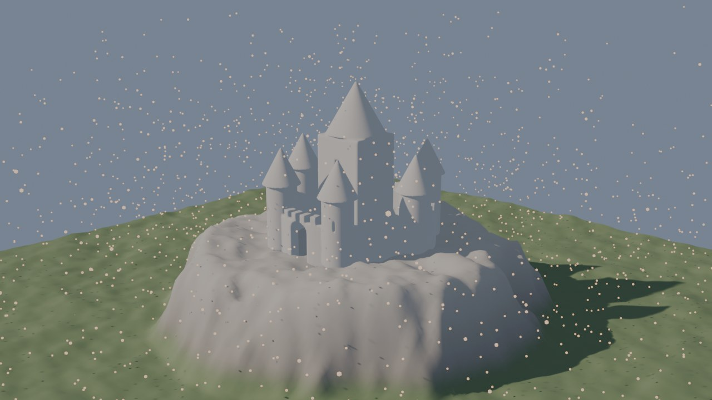
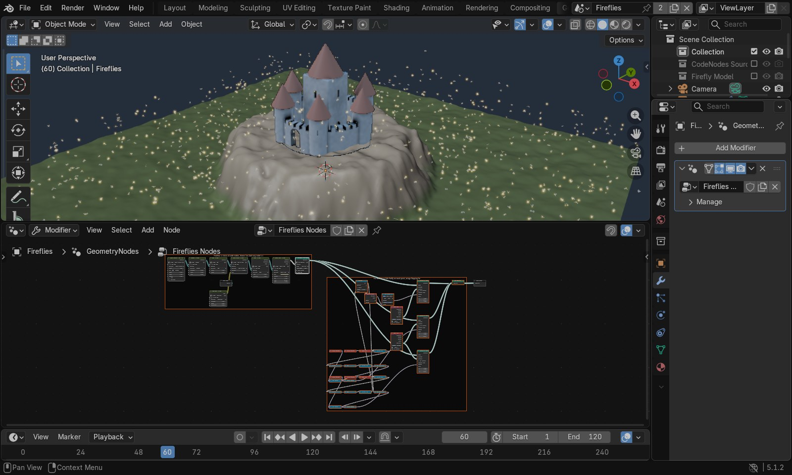
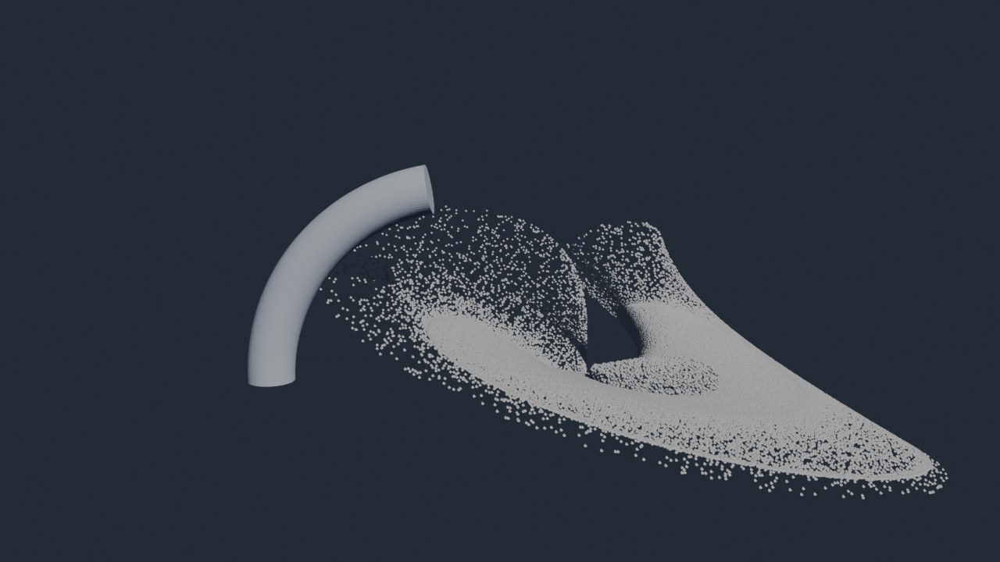
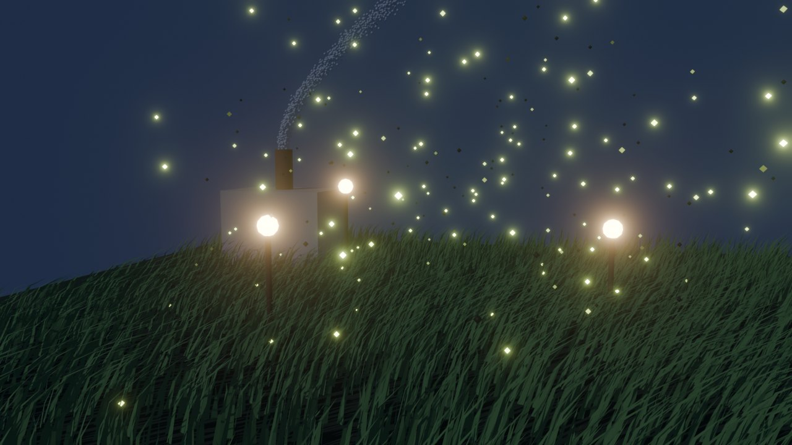
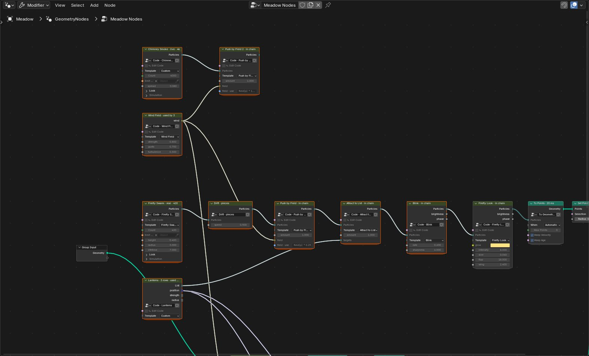
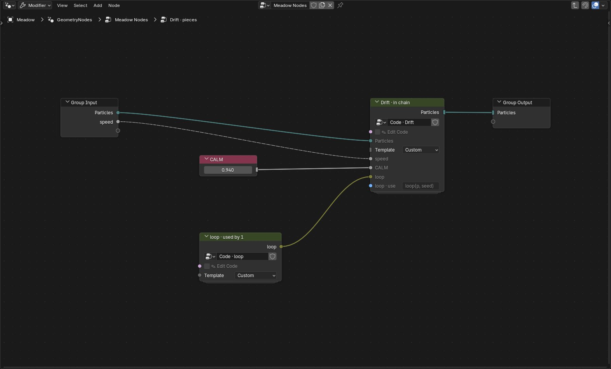
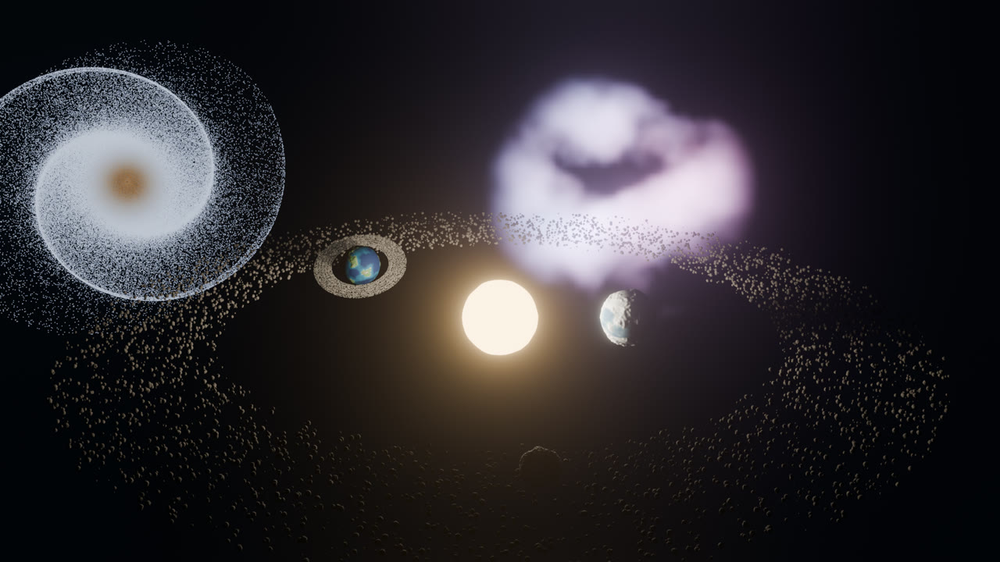

# A tour of the GPU nodes

The GPU side of CodeNodes, hands on: the firefly chain, how a node's sockets come from its code,
rendering, the Windy Meadow and the Galaxy. This was the opening of the README until November 2026.
How it all works, with the limits, is in [GPU_NODES.md](GPU_NODES.md); every node is in
[NODE_REFERENCE.md](NODE_REFERENCE.md).



*The demo scene (`examples/gpu_demo.py`), rendered with F12:*
- *a flat grid shaped into a plateau by a GPU Mesh node*
- *the Aerie citadel as a GPU Surface, raymarched live*
- *fireflies from a chain of six code nodes, with a little firefly model on each for the render*

## Your first five minutes

After installing (see [Install](../README.md#install)), open the demo (build it with `examples/gpu_demo.py`, see
[Quick start](../README.md#quick-start)), or start fresh:

1. Select a mesh (a plane works), open the **Geometry Nodes** editor, and add
   **Shift A › CodeNodes › GPU Particles › Firefly Swarm**. Set its **Emit From** to the plane.
2. Add **Shift A › CodeNodes › Particle Stages › Wander**, **Rise** and **Blink**, and **Particle Looks › Firefly Look**. Wire each one's
   **Particles** output into the next one's **Particles** input. Fireflies appear in the 3D viewport:
   glowing, blinking, wings flapping, drawn straight from the GPU. The source's header says
   `Firefly Swarm · live · 2.5k`, and each stage says `in chain`.
3. Everything you can change is **on the nodes**: each node's sliders come from its code (`strength`,
   `climb`, `rate`, `size`, `flap`…), with the Template dropdown and settings panels beside them.
   **Hover over any socket** for a sentence saying what it does. The timeline doesn't need to play:
   with it paused the viewport keeps simulating, so dragging Wander's `strength` changes the motion
   straight away.
4. Switch on **✎ Edit Code**, a node's first input. Its code pops up in a Text Editor window, and the
   toggle switches itself back off. Double-clicking the node or pressing Ctrl+E does the same. Change
   the code and the fireflies follow as you type. A new `// @in float gust 1 0 5` line becomes a new
   input on the node; a new `// @out attr heat` line becomes a new output. End a line with a sentence
   in quotes (`// @in float gust 1 0 5  "How strong the gusts are"`) and that's its tooltip.
5. **Shift A › CodeNodes › To Geometry** after the last node turns the chain into real points (its
   header reads **To Points**),
   carrying `velocity`, `age` and each attribute the chain declares (Blink's `brightness` and
   `phase`). Wire them into Instance on Points, Set Material or anything else. Set its **When** to
   *Only for Render* to keep the live look in the viewport.
6. **F12** (or Render › Render Image) renders with the GPU nodes included; **Ctrl+F12** renders the
   animation, to the output path in its format (movies too).
7. Code nodes form a **graph**: wire Blink's **Particles** output into both Firefly Look and
   **Streak Look**, and you get glowing heads *and* trails from one simulation. **Join Particles**
   merges two streams; one **Wind Field** can push the fireflies and sway a grass mesh at once.
8. **Scene Lights** lights code nodes with your lamps and world; **Material Look** brings in a
   Blender material. **GPU Cache** bakes a simulation (⟳ Bake Now) and plays it back.

Every node, with its code and every socket, is in [NODE_REFERENCE.md](NODE_REFERENCE.md);
how graphs, baking and lighting work is in [GPU_NODES.md](GPU_NODES.md).

**The kinds of code node** (all in Shift A › CodeNodes, and in 3D View › Add › Mesh):

| Node | You write | Starters |
|---|---|---|
| **GPU Particles** | a source: `spawn(p)`, optionally `update(p, dt)` and `look(p)` | Galaxy, Flow, Attractor (from Myriad), Swirl, Fountain, Firefly Swarm, Spark Ball |
| **GPU Stage** | one step in a chain: `behave(p, dt)`, `born(p)`, `look(p)`, `warp(q)`, `deform(v)`, or functions for other nodes | Wander, Rise, Gravity, Vortex, Drag, Blink, Push by Field, Collide with Shape, Glow Look, Firefly Look, Streak Look, Material Look, Bend, Taper, Ripple, Sway by Field, Wind Field, Scene Lights |
| **Join Particles** / **GPU Cache** | nothing: flow nodes that merge two particle streams, or bake and play back a simulation | — |
| **GPU Surface (SDF)** | `float sdf(vec3 p)`, the distance to the surface; optional `vec3 color(vec3 p)` | Castle (from Aerie), Planet (Tellus-style), Saturn, Donut, Rounded Box, Gyroid Ball, Blob |
| **GPU Mesh** | `void deform(inout Vertex v)`, run on every vertex of the mesh wired into it | Wave, Noise Displace, Mesa, Twist |
| **Code Shape** | a small shape language (profiles, revolve, extrude, sweep); real geometry straight away | Desk Lamp, Vase |



**A node's sockets come from its code:**

```glsl
// @in  float amount 1.0 0 10      a slider           // @in  int   steps 2 1 8     a whole number
// @in  color tint 1 0.6 0.2       a colour           // @in  func  vec3 field(vec3 p)   a function input
// @out attr  heat 0.0             a per-particle value, readable by later nodes (and a field output)
// @out func  force                one of your functions, as an output socket
```

Particles travel on **Particles** sockets, meshes on Geometry sockets, functions on **Closure**
sockets, and attributes come out as float fields. Each node's names get their own prefix, so nodes
never clash. Compile errors name the node and the line you wrote. A **Bend** node works on particles
and meshes alike, and never changes the simulation: straighten it and the swirl is exactly as before.
[GPU_NODES.md](GPU_NODES.md) has the full syntax, how chains combine, the numbers, the limits,
and proposals for the rest of the starter library.



**Live, and converted.** A GPU chain on its own draws straight from GPU memory into the viewport:
- a million particles at about 190 fps
- the six-node firefly chain at about 150
- all depth-tested against your objects

That's a viewport picture: it isn't selectable, and later nodes can't see it. **To Geometry** turns
it into geometry.

**Rendering: just press F12.** Running GPU code while Blender renders crashes Blender, so when a
scene has GPU code nodes, F12, Ctrl+F12 and Render › Render Image / Render Animation take turns, for
each frame:
1. step the GPU chains to that frame
2. convert them (live-only chains just for the render)
3. render that frame, then move on

No bake is needed. Stills land in the Render window, animations are written to the output path in its
format (a movie is written from the rendered frames with Blender's own movie writer), and a scene
without GPU nodes gets Blender's own render. The Rendered viewport keeps drawing the live GPU nodes. A
preference (CodeNodes › "F12 and Render menu include GPU nodes") switches it off. **Command-line and
farm renders** (`blender -b file.blend -a`) include GPU nodes on Blender 5.2 and newer, where background
Blender has a GPU; on 5.0 and 5.1, bake first.

**Tab into a code node** to see its code in a frame, and its full status or error in another. The
Node Editor sidebar (N) only has what Blender can't put on a node: an Edit Code button, an Add To
Geometry button, and the full error text.

**How a code node works under the hood.** Blender doesn't let add-ons define new nodes inside
Geometry Nodes, so a code node is an ordinary **Group node**, and its sockets are the group's inputs
and outputs. Each node you add (or duplicate with Shift D) gets its own code. Values that come in
through a link are followed back to a Value or Integer node, a reroute, or the modifier's own input.
A value computed by other nodes (Math, Scene Time, ...) is evaluated by a hidden helper and read
back, so it works too, frame by frame (a field is read at the origin).
**Make Native** replaces a GPU Surface node with real Geometry Nodes that do the same maths (needs
the ExpressNode add-on), so the file no longer needs CodeNodes at all.

**The separate CodeNodes node editor** (Sidebar › **New Node Graph**, or switch any Node Editor's
type to *CodeNodes*) combines several distance functions into one GPU program with Combine (union,
subtract, blend), Transform and Offset nodes. The starter graph makes a small Saturn.

## The modular workflow: the Windy Meadow

Pull a script apart, share the pieces, and let each node use them its own way.
`examples/meadow_demo.py` builds this scene and renders it with no window (Blender 5.2):



- **Use lines: one wind, three meanings.** One **Wind Field** is wired into three nodes, and its header
  says `used by 3`. Every function input has a use line under it saying how that node applies what's
  wired in. The grass's **Sway by Field** uses `vec3(field(p).xy, 0.0) * 1.4` (sideways only). The
  fireflies' **Push by Field** uses `field(p) * 0.25` (a gentle drift). The smoke's uses
  `field(p) * 1.2 + vec3(0.0, 0.0, amount * 0.4)` (it bends and rises). Type on the node or in the
  code: they stay in sync.
- **Lists: data on the graph.** **Lanterns** is a List node, a table of positions and pulls. The
  fireflies' **Attract to List** reads it in code (`targets(i).strength`), and native nodes read the
  same table (Get List Item → Points → Instance on Points) to stand a lantern on every row. Add a row
  and there's another lantern, with fireflies gathering round it.
- **Explode: a script's pieces as nodes.** **Drift** is exploded. Double-click (or Tab) into it like
  any node group: its `CALM` constant is a Value node and its `loop()` helper is a node of its own,
  both wired into what's left of Drift. Right-click › Collapse Into Code puts them back exactly.
  Any code nodes can be grouped with Ctrl+G too, and chains run straight through the group.





## On the web

Select an object with GPU particle chains, GPU Surfaces or mesh chains and click **Export Live Web Page** in the sidebar: you get a
page that runs those chains in the browser (WebGL2), the same code that runs in your viewport, with each
node's sliders as page controls. Serve the folder (`python -m http.server`) and open it.

## A bigger example: the Galaxy

The firefly chain is one line of nodes. The Galaxy scene (`examples/galaxy_demo.py` builds it, and
`examples/galaxy_scene.py` is the code) shows what a *graph* of code nodes adds to Geometry Nodes: a
solar system in front of a spiral galaxy and a nebula, where the systems share functions and act on
each other. Select **Solar System** and its node tree shows four labelled frames:



1. **Shared Orbit: one node, many consumers.** The **Orbits** node has no stream. It gives out
   functions: `planetPos(i, t)`, `planetRadius(i)`, `planetMass(i)` and `planetCount()`. The planets'
   placement, the asteroids' gravity, their collisions and the ring all call those same functions.
   Pick **Figure Eights** in Orbits' Template dropdown and all of them follow the new paths at once:
   the planets trace figures of eight, the asteroids feel them in their new places, and the ring
   goes along.
2. **Reuse: one node, three planets.** Three **Planet Terrain** nodes (the same starter, a GPU Mesh)
   with different seeds and sea levels make a rocky world, an ocean world and an ice world. Each is
   painted by a **Colour by Height** node. It's the Mesa idea on a sphere, and yes, it combines with
   anything, because its input and output are ordinary geometry.
3. **Native + GPU: they take turns.** Ico Sphere (native) → Planet Terrain (GPU) → Colour by Height
   (GPU) → To Mesh → Set Material (native) → Geometry to Instance → Instance on Points (native). The
   points it instances on come from a GPU node, **Points from Function**, which places one point per
   planet with Orbits' `planetPos` and writes `bodySize` for Instance on Points' Scale.
4. **Interaction: systems act on each other.** An asteroid **Belt** runs through **Gravity to
   Bodies** (pulled by the star and every planet) and **Collide with Bodies** (bouncing off them; none
   ever ends up inside one), then To Points and Instance on Points turn it into lumpy rocks. A
   **Ring** of dust goes round the second planet through **Follow Body**.

Around it: a **Sun** (a GPU Surface lit by its own emission, with a real Point light parented to it,
so the real planets are lit), a **Galaxy** of a million stars coloured by temperature (**Star
Colours** writes a `temp` attribute that a Blackbody node uses in renders), and a **Nebula** (GPU
sprites live; a real volume from ordinary nodes, Volume Cube from noise, switched on for renders
with Is Viewport).

**Timing:** orbits use `uSceneTime`, the timeline's time. While the viewport previews a paused
scene, the asteroids keep moving, but the planets they orbit stay where the real planets are.
